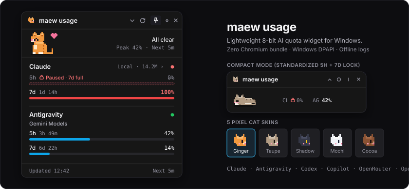

# maew usage

A lightweight, privacy-first Windows desktop widget for monitoring AI coding quotas — featuring a minimal 8-bit chubby cat companion.

[](LICENSE)
[](#requirements)
[](pyproject.toml)



`maew usage` sits quietly in the corner of your screen (or Windows System Tray) so you know when your **5-hour** or **7-day** AI coding limits are close to running out — without opening browser tabs or burning tokens.

---

## Why `maew usage`?

Most desktop usage monitors bundle an entire 150–200 MB Chromium runtime (`Electron` or `PyQt6-WebEngine`). `maew usage` takes a leaner path:

- **Uses Windows' built-in Edge WebView2** via `pywebview` — no bundled Chromium engine, tiny disk footprint, and low idle RAM (hidden web sync windows are destroyed immediately after reading).
- **Weekly-cap lock clarity**: when a provider's `7d` (weekly) limit reaches `100%`, its `5h` gauge automatically switches to **`Paused · 7d full`** with a padlock icon and red status dot, so you never mistake `5h: 0%` for usable quota.
- **Standardized Compact Mode**: always shows each provider's `5h` session percentage (`CL 0%`, `AG 42%`) plus a red padlock whenever `7d` is capped.
- **Built-in Local Harness Scanner**: click **Scan** in Settings to detect installed CLIs (`agy`, `claude`, `codex`, `gh`, `opencode`) and local log folders offline without reading external credentials.
- **Zero telemetry, encrypted secrets**: API keys and PATs are encrypted with **Windows DPAPI** (`crypt32.dll`), fonts (`IBM Plex Sans`, `JetBrains Mono`) are self-hosted locally, and browser sign-ins use an isolated WebView2 profile that never touches your main Chrome or Edge profile.

### Status & Non-Goals

- **Current status:** `v1.0.0` (actively maintained, MIT licensed).
- **Windows only in v1.0.0:** Built around Windows Edge WebView2 and Windows DPAPI (`crypt32.dll`). macOS and Linux are not currently targeted.
- **Unofficial web scrapers may break:** `Claude.ai` and `Codex` web gauges read the rendered usage pages in an isolated WebView2 window. If Anthropic or OpenAI change their page layout, those gauges will show a clean error/stale indicator until updated (see [Provider issue template](.github/ISSUE_TEMPLATE/provider_broken.yml)).

---

## Supported Providers

Claude and Antigravity are enabled by default; all other providers are built in and can be toggled on in **Settings → Providers**.

| Provider | Compact Code | Auth / Data Source | Gauges | Notes |
| --- | --- | --- | --- | --- |
| **Claude** | `CL` | Isolated WebView2 (`claude.ai/settings/usage`) | `5h`, `7d` (+ `Fable` on Max) | Includes collapsible offline `Local` drawer reading `~/.claude/projects/**/*.jsonl` |
| **Antigravity** | `AG` | Local `agy --print /quota` CLI | `5h`, `7d` (Gemini & Claude+GPT) | Zero-token Safety Latch stops polling if `num_turns > 0` or `total_tokens > 0` |
| **Codex** | `CX` | Isolated WebView2 (`chatgpt.com/settings/usage`) | `5h`, `7d` | Includes label-free `<progress>` fallback |
| **GitHub Copilot** | `CP` | GitHub Billing REST API (DPAPI PAT) | `30d` | Supports AI Credits & legacy Premium Requests; configurable monthly quota |
| **OpenRouter** | `OR` | OpenRouter `/api/v1/key` & `/credits` | `24h`, `Credits` | Optional daily USD budget for percentage tracking |
| **OpenCode Go** | `OC` | OpenCode `/zen/go/v1/usage` | `5h`, `7d`, `30d` | Handles `rate-limited` status automatically |
| **MiniMax** | `MM` | MiniMax Coding Plan API (Intl / China) | `5h`, `7d` | Refuses HTTP 3xx redirects (`allow_redirects=False`) to protect API keys |

---

## Requirements

- **OS:** Windows 10 or Windows 11 with **Microsoft Edge WebView2 Runtime** (pre-installed on Windows 11 and modern Windows 10).
- **Python:** 3.11 or newer (only required when running from source).

---

## Installation & Quick Start

### Option 1: One-Line Install — Scoop / `uv` / `pipx` (Recommended — No SmartScreen Prompt)

**With [Scoop](https://scoop.sh/)** (no Python required, creates a Start Menu shortcut automatically):

```powershell
scoop install https://raw.githubusercontent.com/ieatbaozi-stack/maew-ai-check/main/bucket/maew-usage.json
```

Or add the bucket to receive updates via `scoop update maew-usage`:

```powershell
scoop bucket add maew https://github.com/ieatbaozi-stack/maew-ai-check
scoop install maew/maew-usage
```

**With [`uv`](https://docs.astral.sh/uv/) or [`pipx`](https://pipx.pypa.io/)** (installs a windowless `maew-usage` command on your `PATH`):

```powershell
# Using uv
uv tool install git+https://github.com/ieatbaozi-stack/maew-ai-check.git

# Or using pipx
pipx install git+https://github.com/ieatbaozi-stack/maew-ai-check.git
```

Then launch anytime with:

```powershell
maew-usage
```

### Option 2: Download Pre-Built Windows Release

1. Go to the **[Releases](https://github.com/ieatbaozi-stack/maew-ai-check/releases/latest)** page and download `maew-usage-v1.0.0-windows-x64.zip`.
2. Verify the checksum against `SHA256SUMS.txt` (optional):
   ```powershell
   Get-FileHash .\maew-usage-v1.0.0-windows-x64.zip -Algorithm SHA256
   ```
3. Extract the folder and run `maew-usage.exe`.

> **Note on Windows Defender SmartScreen:** Pre-built `.zip` releases are currently unsigned open-source builds, so Windows may show a SmartScreen prompt on first launch when downloaded through a browser. Click **More info → Run anyway**, or install via **Option 1** (Scoop / `uv` / `pipx`) for a zero-warning setup.

### Option 3: Run from Source or Build Locally

```powershell
git clone https://github.com/ieatbaozi-stack/maew-ai-check.git
cd maew-ai-check

python -m venv .venv
.\.venv\Scripts\python.exe -m pip install -e ".[dev]"

# Launch without a console window
.\.venv\Scripts\pythonw.exe run.py

# Or build your own standalone dist\maew-usage\maew-usage.exe
.\scripts\build.ps1
```

---

## Setting Up Providers

Click the **Settings** (gear) icon in the top-right corner of the widget:

1. **Auto-detect installed harnesses:** Click **Scan** under **Providers**. `maew usage` checks locally for installed CLIs and log folders without running external commands or reading other tools' credentials.
2. **Antigravity:** Works automatically if `agy` is on your `PATH` or installed at `%LOCALAPPDATA%\agy\bin\agy.exe`.
3. **Claude.ai (5h / 7d web quota):** Click **Connect Claude.ai** to sign in inside an isolated WebView2 window. The window closes automatically once signed in.
4. **Claude Code (offline local logs):** Enabled by default — click **`Local ›`** next to **Claude** on the main panel to expand 5h / Today / 7d token counts and estimated API-equivalent cost from `~/.claude/projects/**/*.jsonl`.
   - To customize or add new model rates without updating the app, place an override file at `%APPDATA%\maew-ai-check\rates.override.json` using the same structure as [`src/maew/providers/rates.json`](src/maew/providers/rates.json).
5. **API-Key Providers (Copilot, OpenRouter, OpenCode Go, MiniMax):** Toggle the provider on, paste your key, and click **Set**. Keys are encrypted immediately with Windows DPAPI and stored in `%APPDATA%\maew-ai-check\secrets.dat`.

### Adaptive Polling Behavior

To avoid rate limits and keep CPU/RAM near zero while idle:
- **Active mode:** refreshes every **5 minutes** (configurable) for 30 minutes after startup, manual refresh, or any detected quota change.
- **Idle backoff:** doubles the wait interval on unchanged cycles (`5m → 10m → 20m → 40m → 60m` max).
- **Reset-aware refresh:** automatically pulls the next check forward to `resets_at + 1 minute` so gauges reset cleanly right after a window rolls over.

---

## Security & Privacy

`maew usage` makes **zero telemetry, analytics, or auto-update requests**. All outbound connections go exclusively to the official endpoints of providers you enable, and all local data lives under `%APPDATA%\maew-ai-check\`.

For the complete outbound domain allowlist, DPAPI threat model, subprocess safeguards, and vulnerability reporting process, see **[SECURITY.md](SECURITY.md)**.

---

## Development

```powershell
# Install with dev dependencies
.\.venv\Scripts\python.exe -m pip install -e ".[dev]"

# Run unit tests (19 tests covering parsers, DPAPI, safety latch, scheduler, scanner)
.\.venv\Scripts\pytest.exe -v

# Check frontend JavaScript syntax
node --check src/maew/frontend/cat-sprites.js
node --check src/maew/frontend/app.js
```

Want to add a new AI provider or fix an extractor? See **[CONTRIBUTING.md](CONTRIBUTING.md)** for the 4-step plugin guide and PR checklist. Release history is tracked in **[CHANGELOG.md](CHANGELOG.md)**.

---

## Acknowledgments

Provider integration research, adaptive refresh cadence, and the Antigravity zero-token safety latch design were inspired by [`jpajak/ai-gauge`](https://github.com/jpajak/ai-gauge).

## License

Released under the [MIT License](LICENSE).
